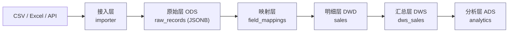
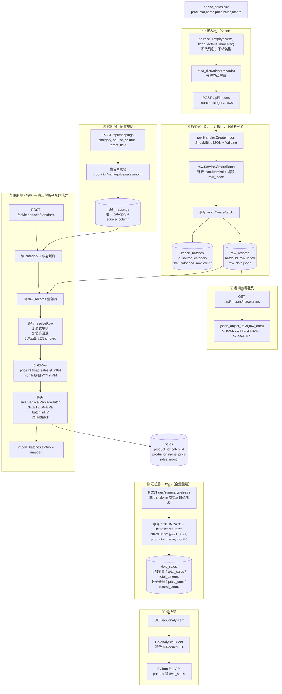
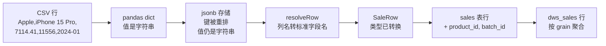
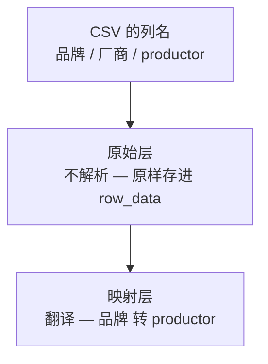
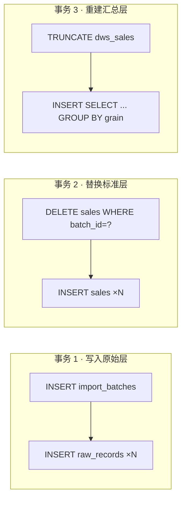
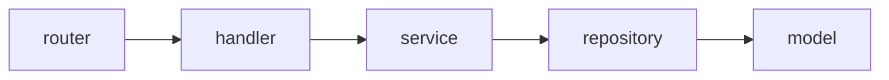
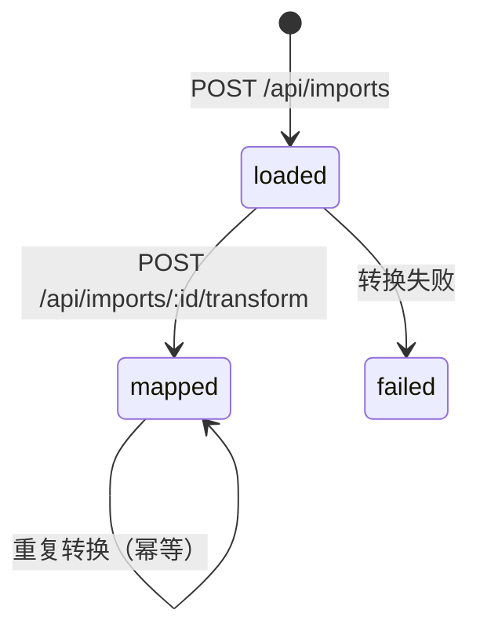

# 架构说明：分层数据平台

> 一句话定位：**Go + Python 构建的数据接入与分析平台，采用 ODS → DWD → DWS → ADS 分层思想，实现插件化接入与配置化字段映射。**

技术栈：Go（Gin + GORM + PostgreSQL）负责 API 与事务；Python（FastAPI + Pandas）负责分析与接入；两者通过 REST 解耦，`X-Request-ID` 跨语言串联日志。

---

## 1. 分层总览



| 层 | 职责 | 变化频率 |
|---|---|---|
| 接入层 | 把文件读成「行」 | 加新数据源时改 |
| 原始层 | **原样存 JSONB，不解析** | 几乎不变 |
| 映射层 | 用户列名 → 系统标准字段 | 每个来源可不同 |
| 明细层 | 统一结构，供分析 | 加新字段时改 |
| 汇总层 | 预聚合，加速报表 | 加新指标/粒度时改 |
| 分析层 | 聚合、报表 | 加新报表时改 |

**核心洞察**：用户输入永远先进原始层，**永远不直接进标准层**。这是解决「表格一变就出 bug」的根本方法。

**与数仓分层的对应**：

| 数仓分层 | 本项目 |
|---|---|
| ODS（原始层） | `raw_records`（JSONB，列名原样） |
| DWD（明细层） | `sales`（映射后的标准明细） |
| DWS（汇总层） | `dws_sales`（按 grain 预聚合） |
| ADS（应用层） | `analytics` 报表（Python 查询） |

---

## 2. 端到端流程（七个阶段）



---

## 3. 数据形态流转

同一条数据一路的形态变化：



| 阶段 | 数据形态 | **列名状态** | 值类型 |
|---|---|---|---|
| ① CSV | 文本行 | `productor,name,price,sales,month` | 文本 |
| ① pandas | `DataFrame` | 原样 | 文本（`dtype=str`） |
| ① dict | `{productor: Apple, ...}` | 原样 | 文本 |
| ② HTTP JSON | 同 dict | 原样 | 文本 |
| ② `raw_records.row_data` | **jsonb** | **原样**（jsonb 重排键顺序） | 文本 |
| ⑤ `resolveRow` | `map[string]string` | **翻译成标准字段名** | 文本 |
| ⑤ `buildRow` | `sale.SaleRow` | 标准字段 | **已转换** |
| ⑤ `sales` 行 | 关系表列 | 标准字段 | 关系类型 |
| ⑥ `dws_sales` 行 | 聚合结果 | 标准字段（维度） | 数值 + 分子分母 |

---

## 4. 关键设计：列名被「处理」两次



| | 原始层 | 映射层 |
|---|---|---|
| 对列名的态度 | **完全不碰** | **全部翻译** |
| 依据 | 无 | `field_mappings` + 恒等回退 |
| 列名出现在哪 | `row_data` 的**键** | 转换逻辑的**输入** |
| 目的 | 保留真相，任意表格都能存 | 产出统一结构，分析层不关心来源 |

### 列名解析的三级优先级

```
1. 显式规则      field_mappings: source_column → target_field
2. 恒等回退      源列名本身就在标准字段白名单里
3. 未匹配        记入 ignored_columns（数据不丢，只是本次转换用不上）
```

**「多来源 → 同一目标字段」是被允许的**（不同商家用不同写法），所以：

- 唯一约束是 `(category, source_column)`，**故意不加** `target_field` 唯一约束
- 转换时按「这一行里实际出现了哪个源列」解析
- 若一行里出现两个源列指向同一目标字段 → **报错**，不静默随机取值

### 列顺序无关

全程按**列名**匹配，与顺序无关：

- Python：`to_dict(orient="records")` → 字典，顺序已丢
- 存储：`jsonb` 会重排键（按长度 + 字典序）
- Go：`map[string]any` + `range` 迭代顺序本身随机

---

## 5. 事务边界



| 事务 | 语义 | 收益 |
|---|---|---|
| 原始层写入 | 批次头 + 全部原始行，**全成或全败** | 不会出现「有批次没数据」 |
| 标准层替换 | **先删后插** | **幂等**：同批次重复转换不翻倍 |
| 汇总层重建 | **先清空再重算** | 汇总是派生数据，永远可重建 |

转换失败时：整批不写，`sales` 保持原样，批次状态不变。任何一行的问题都会带**行号**返回。

---

## 6. 汇总层（DWS）设计

分析层如果每次都扫 `sales` 明细做聚合，数据量一大就会变慢。汇总层把常用聚合**预先算好**。

### 6.1 粒度

```
dws_sales: (product_id, productor, name, month)
```

选它的理由：**这是能支撑全部现有报表的最小维度组合**。

- 再粗（只到 `productor, month`）→ 答不了 `top-products`（需要 `name`）
- 再细（保留明细行）→ 那就还是明细表本身

细粒度可以「上卷」到任意粗粒度，反之不行：

| 报表 | 在 `dws_sales` 上怎么算 |
|---|---|
| 品牌排行 | `GROUP BY productor` |
| 月度趋势 | `GROUP BY month` |
| 热销商品 | `GROUP BY productor, name` |
| 全局汇总 | 全表聚合 |

### 6.2 可加性：为什么必须存分子分母

数仓里的度量分三类，本项目实际踩到了「不可加」这一种：

| 度量 | 类型 | 能否跨行 SUM |
|---|---|---|
| `total_sales = SUM(sales)` | 可加 | ✅ |
| `total_amount = SUM(price * sales)` | 可加 | ✅ |
| `min_price / max_price` | 可加 | ✅（可再 MIN/MAX） |
| **`avg_price`** | **不可加** | ❌ `AVG(AVG(x)) ≠ AVG(x)` |

所以表里**不存 `avg_price`**，而是存分子分母：

```
price_sum    = SUM(price)   ← 分子
record_count = COUNT(*)     ← 分母
```

任意层级的平均价 = `SUM(price_sum) / SUM(record_count)`

验证：`SUM(price_sum) / SUM(record_count)` = 全体 price 之和 / 全体行数 = 明细层的 `AVG(price)` ✓

> `batch_count`（即 `COUNT(DISTINCT batch_id)`）同样不可加，只作为**血缘提示**展示，跨行 SUM 没有意义。

### 6.3 刷新策略：全量 vs 增量

**当前采用方案 A：全量重建**

```sql
BEGIN;
TRUNCATE dws_sales;
INSERT INTO dws_sales (...)
SELECT product_id, productor, name, month,
       SUM(sales), SUM(price * sales), SUM(price), COUNT(*),
       MIN(price), MAX(price), COUNT(DISTINCT batch_id), now()
FROM sales
GROUP BY product_id, productor, name, month;
COMMIT;
```

| 优点 | 缺点 |
|---|---|
| 逻辑极简，正确性一眼可见 | O(N) 全表扫描 |
| 一个事务，天然原子 | 无法只更新局部 |
| 无状态——任何时刻重跑都能修好 | |

**将来可升级为方案 B：增量刷新**（只重算受影响的 grain）

```sql
CREATE TEMP TABLE affected AS
SELECT DISTINCT product_id, productor, name, month
FROM sales WHERE batch_id = ANY($1);
```

> ⚠️ 关键陷阱：同一个 `(品牌, 机型, 月份)` 可能由**多个批次**共同贡献，因此必须从**整个 `sales`** 重算这些 grain，而不能只重算该批次的行。

**触发时机**：

```
transform 成功           ──► 自动刷新（mapping.Service.WithSummary 注入）
POST /api/summary/refresh ──► 手动 / 定时刷新
```

刷新失败**不会**让 transform 失败——明细已写入，汇总是派生数据，可以稍后重建（错误通过 `summary_error` 返回）。

### 6.4 一致性

**核心原则：明细是唯一真相来源，汇总是派生数据。不一致时重建汇总，绝不改明细。**

| 风险 | 对策 |
|---|---|
| 刷新中断 | 单个事务内 `TRUNCATE + INSERT`，原子 |
| 刷新时并发写入 | 单实例下靠事务；多实例需分布式锁 |
| 有人直接改了 `sales` | 提供对账接口 `GET /api/summary/verify` |
| 汇总落后于明细 | `updated_at` + 重新 refresh |

对账用双向 `EXCEPT`：

```sql
WITH detail AS (
    SELECT product_id, productor, name, month, SUM(sales) AS total_sales
    FROM sales
    GROUP BY product_id, productor, name, month
),
dws AS (
    SELECT product_id, productor, name, month, SUM(total_sales) AS total_sales
    FROM dws_sales
    GROUP BY product_id, productor, name, month
)
SELECT * FROM detail EXCEPT SELECT * FROM dws
UNION ALL
SELECT * FROM dws EXCEPT SELECT * FROM detail;
```

两个方向都为空 = 一致（接口返回 `ok: true`）。

---

## 7. 代码位置对照

| 阶段 | 入口 | 核心逻辑 |
|---|---|---|
| ① 接入 | `python_code/app/modules/importer/` · `import_raw.py` | `CsvReader.parse` + `ImporterService` |
| ② 原始层 | `go_api/internal/raw/handler.go` → `service.go` | `CreateBatch` + `repo.CreateBatch` |
| ③ 列名 | `go_api/internal/raw/repository.go` | `ListColumns`（`jsonb_object_keys`） |
| ④ 规则 | `go_api/internal/mapping/handler.go` → `service.go` | `Upsert` + 白名单校验 |
| ⑤ 转换 | `go_api/internal/mapping/` | `Transform` → `resolveRow` / `buildRow` |
| ⑥ 汇总 | `go_api/internal/summary/` | `RefreshAll`（全量重建）+ `Verify`（对账） |
| ⑦ 分析 | `go_api/internal/analytics/` → `python_code/app/` | HTTP 代理 + pandas 聚合 |

### 依赖方向（严格单向）



- handler 只做 HTTP 入参/出参
- service 承载业务规则与事务边界
- repository 独占数据访问
- 跨模块依赖由**消费方定义接口**（如 `mapping.RawReader` / `mapping.SaleWriter`），实现方隐式满足

---

## 8. 接口清单

### 接入层（Python）

| 方法 | 路径 | 作用 |
|---|---|---|
| `POST` | `/import/upload` | 上传 CSV/Excel，解析后转发给 Go 原始层 |

### 原始层

| 方法 | 路径 | 作用 |
|---|---|---|
| `POST` | `/api/imports` | 写入原始数据（原样，不解析） |
| `GET` | `/api/imports/:id` | 该批次的原始行数 |
| `GET` | `/api/imports/:id/columns` | 列出该批次出现过的列名 + 样本值 |

### 映射层

| 方法 | 路径 | 作用 |
|---|---|---|
| `POST` | `/api/mappings` | 配置/覆盖一条映射规则（upsert） |
| `GET` | `/api/mappings?category=` | 查看某品类的规则 |
| `POST` | `/api/imports/:id/transform` | 原始层 → 明细层转换（幂等） |

### 汇总层

| 方法 | 路径 | 作用 |
|---|---|---|
| `POST` | `/api/summary/refresh` | 全量重建 `dws_sales`（幂等） |
| `GET` | `/api/summary/verify` | 对账：明细 vs 汇总，`ok:true` 表示一致 |

### 明细层 / 分析层

| 方法 | 路径 | 作用 |
|---|---|---|
| `GET` | `/api/products` · `POST` `/api/products` | 品类管理 |
| `POST` | `/api/sales/batch` | 明细层写入（调试/内部用） |
| `GET` | `/api/analytics/sales` | 销售汇总 |
| `GET` | `/api/analytics/top-products` | 热销商品 |
| `GET` | `/api/analytics/brands` | 品牌排行 |
| `GET` | `/api/analytics/monthly-trend` | 月度趋势 |

---

## 9. 数据库表

| 表 | 层 | 说明 |
|---|---|---|
| `import_batches` | 原始层 | 批次元信息：source / category / status / row_count |
| `raw_records` | 原始层 | `row_data` **JSONB**，键即用户表格原始列名 |
| `field_mappings` | 映射层 | 唯一 `(category, source_column)` |
| `sales` | 明细层（DWD） | 统一结构，`batch_id` 可溯源 |
| `dws_sales` | 汇总层（DWS） | 唯一 `(product_id, productor, name, month)`；含分子分母 |
| `products` | 品类 | 品类维度（phone / laptop） |

### 批次状态流转



---

## 10. 可扩展性演示

**场景：换个商家，列名不同**

```json
批次 1: {"productor":"Apple", "name":"iPhone 15 Pro", "price":"7114.41", "sales":"11556", "month":"2024-01"}
批次 2: {"厂商":"Apple", "型号":"iPhone 16", "单价":"8000", "月销量":"1234", "月份":"2025-01"}
```

只需为 `category = phone` 补 5 条映射规则：

```
厂商 → productor   型号 → name   单价 → price   月销量 → sales   月份 → month
```

**零代码改动**，两批数据产出完全同构的 `sales` 行。

**场景：加新字段（地区）**

`sales` 加一列 `region`；映射规则加一条 `地区 → region`；分析时 `GROUP BY region`。只加字段，不改逻辑。

**场景：接入 Excel / API**

接入层加一个 `ExcelImporter` / `APIImporter`，后面几层完全复用。这就是「开放扩展」的正确姿势。

---

*本文档随架构演进更新。*
