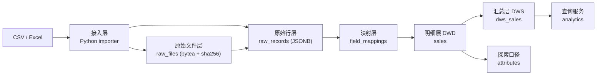
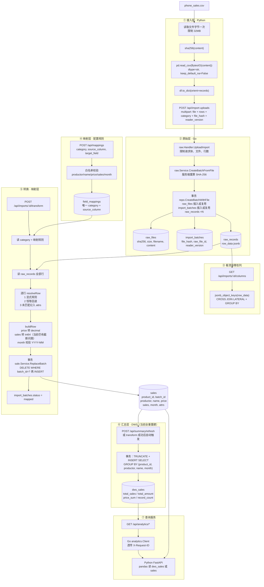
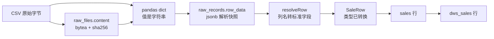
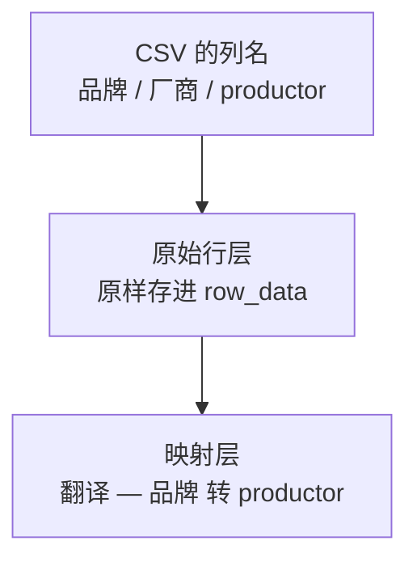
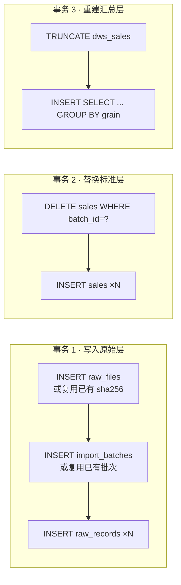
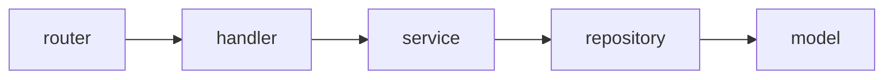
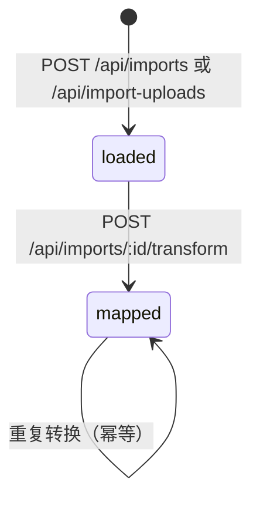

# 架构说明：分层数据平台

> 一句话定位：**Go + Python 构建的数据接入与分析平台，采用 ODS → DWD → DWS → 查询服务的分层思想，实现文件留存、指纹去重、配置化字段映射与汇总报表。**
>
> 技术栈：Go（Gin + GORM + PostgreSQL）负责 API、事务与原始层落库；Python（FastAPI + Pandas）负责文件接入、解析与分析查询；两者通过 REST 解耦，`X-Request-ID` 跨语言串联日志。

---

## 1. 分层总览



| 层 | 职责 | 变化频率 |
|---|---|---|
| 接入层 | 接收文件、计算指纹、解析成行 | 加新数据源时改 |
| 原始文件层 | 保存原始字节和 SHA-256，支持重放与去重 | 几乎不变 |
| 原始行层 | 保存解析后的行快照，列名保持源表写法 | 解析规则变化时追加版本 |
| 映射层 | 用户列名 → 系统标准字段 | 每个来源可不同 |
| 明细层 | 统一结构，供分析 | 加新字段时改 |
| 汇总层 | 预聚合，加速报表 | 加新指标/粒度时改 |
| 查询服务 | 聚合、报表，不物化结果 | 加新报表时改 |

**核心约束**：用户输入先进入原始文件层和原始行层，再经过映射进入明细层。原始字节是最终真相，`raw_records` 是可重算的解析快照，`sales` 与 `dws_sales` 都是派生数据。

**与数仓分层的对应**：

| 数仓分层 | 本项目 |
|---|---|
| ODS（原始层） | `raw_files`（原始字节 + SHA-256）与 `raw_records`（解析快照） |
| DWD（明细层） | `sales`（映射后的标准明细） |
| DWS（汇总层） | `dws_sales`（按 grain 预聚合） |
| ADS（应用层） | `analytics` 查询服务；当前没有物化结果表 |

---

## 2. 端到端流程



---

## 3. 数据形态流转



| 阶段 | 数据形态 | 列名状态 | 值类型 |
|---|---|---|---|
| 上传 | 原始字节 | 原样 | 字节 |
| `raw_files.content` | `bytea` | 原样 | 字节 |
| pandas | `DataFrame` | 原样 | 文本（`dtype=str`） |
| `raw_records.row_data` | `jsonb` | 原样（jsonb 重排键顺序） | 文本 |
| `resolveRow` | `map[string]string` | 翻译成标准字段名 | 文本 |
| `buildRow` | `sale.SaleRow` | 标准字段 | `decimal` / `int64` / 字符串；销量整数校验尚待补 |
| `sales` | 关系表列 | 标准字段 | 关系类型 |
| `dws_sales` | 聚合结果 | 维度 + 度量 | 数值 + 分子分母 |

---

## 4. 文件指纹与幂等

### 4.1 指纹来源

SHA-256 在 Python 接入层对**原始字节**计算一次，Go 原始层收到文件后**重新计算**并以服务端结果为准。客户端提交的 `file_hash` 只用于一致性校验，不能替代服务端计算。

### 4.2 存储模型

| 表 | 关键字段 | 说明 |
|---|---|---|
| `raw_files` | `sha256` 唯一、`size`、`filename`、`content bytea` | 同一份字节全局只存一份 |
| `import_batches` | `file_hash`、`raw_file_id`、`reader_version` | 记录批次对应的文件和解析器版本 |
| `raw_records` | `batch_id`、`row_index`、`row_data` | 解析快照，可随时从原始文件重算 |

### 4.3 去重语义

| 场景 | 行为 |
|---|---|
| 同一文件、同一品类 | 返回已有批次，`duplicated=true`，不新增 `raw_records` |
| 同一文件、不同品类 | 复用 `raw_files`，新建批次 |
| 文件内容变化 | SHA-256 变化，新建文件和批次 |
| 旧 `POST /api/imports` | 不保存文件、不参与指纹去重 |
| `reader_version` 变化 | 当前仍返回已有批次；需要重解析时走显式重放接口 |


### 4.4 原始层不解析列名

原始文件层保存字节，不关心列名；`raw_records` 保存解析后的键值，但**列名保持源表原始写法**。列名的翻译只发生在映射层。

---

## 5. 列名被处理两次



| | 原始行层 | 映射层 |
|---|---|---|
| 对列名的态度 | 完全不碰 | 全部翻译 |
| 依据 | 无 | `field_mappings` + 恒等回退 |
| 列名出现在哪 | `row_data` 的键 | 转换逻辑的输入 |
| 目的 | 保留源表结构 | 产出统一结构 |

### 列名解析的三级优先级

```text
1. 显式规则      field_mappings: source_column -> target_field
2. 恒等回退      源列名本身就在标准字段白名单里
3. 未匹配        记入 ignored_columns，同时值写入 sales.attrs
```

**多来源到同一目标字段是被允许的**：

- 唯一约束是 `(category, source_column)`，故意不加 `target_field` 唯一约束。
- 转换时按这一行里实际出现了哪个源列解析。
- 若一行里出现两个源列指向同一目标字段，直接报错，不静默随机取值。

### 列顺序无关

- Python 的 `to_dict(orient="records")` 已经丢失列顺序。
- `jsonb` 会重排键顺序。
- Go 使用 `map[string]any`，迭代顺序本身随机。

---

## 6. 事务边界



| 事务 | 语义 | 收益 |
|---|---|---|
| 原始层写入 | 文件、批次、原始行全成或全败 | 不出现有文件没批次、有批次没行 |
| 标准层替换 | 先删后插 | 同批次重复转换不翻倍 |
| 汇总层重建 | 先清空再重算 | 汇总是派生数据，永远可重建 |

转换失败时整批不写，`sales` 保持上一版，批次状态不变。任何一行的问题都会带行号返回。

---

## 7. 汇总层（DWS）设计

分析层如果每次都扫 `sales` 明细做聚合，数据量一大就会变慢。汇总层把常用聚合预先算好。

### 7.1 粒度

```text
dws_sales: (product_id, productor, name, month)
```

这个粒度支撑四类结构化报表：

- 品牌排行：`GROUP BY productor`
- 月度趋势：`GROUP BY month`
- 热销商品：`GROUP BY productor, name`
- 全局汇总：全表聚合

**属性报表不在这个粒度内**：`attributes` 依赖 `sales.attrs`，当前直接扫描明细，属于探索口径，不是确认口径。若要纳入确认口径，需要新增 `dws_sales_attrs(key, value, ...)` 辅助汇总表。

### 7.2 可加性：为什么存分子分母

| 度量 | 类型 | 能否跨行 SUM |
|---|---|---|
| `total_sales = SUM(sales)` | 可加 | 是 |
| `total_amount = SUM(price * sales)` | 可加 | 是 |
| `min_price / max_price` | 可再 MIN/MAX | 是 |
| `avg_price` | 不可加 | 否，`AVG(AVG(x)) != AVG(x)` |

所以表里不存 `avg_price`，而是存分子分母：

```text
price_sum    = SUM(price)   # 挂牌价分子
record_count = COUNT(*)     # 记录数分母
```

任意层级的挂牌均价 = `SUM(price_sum) / SUM(record_count)`。

成交均价 = `SUM(total_amount) / SUM(total_sales)`，由查询时计算。

`batch_count = COUNT(DISTINCT batch_id)` 只作为血缘提示，跨行 SUM 没有意义；手工批次 `batch_id IS NULL` 不计入。

### 7.3 刷新策略：当前全量重建

```sql
BEGIN;
TRUNCATE dws_sales;
INSERT INTO dws_sales (...)
SELECT product_id, productor, name, month,
       SUM(sales), SUM(price * sales), SUM(price), COUNT(*),
       MIN(price), MAX(price), COUNT(DISTINCT batch_id), now()
FROM sales
GROUP BY product_id, productor, name, month;
COMMIT;
```

| 优点 | 缺点 |
|---|---|
| 逻辑简单，正确性容易验证 | O(N) 全表扫描 |
| 单事务原子 | 无法只更新局部 |
| 无状态，可随时重跑 | 请求链路内同步执行，数据量大时阻塞分析读 |

将来的增量刷新需要先求受影响的 grain，再从整个 `sales` 重算这些 grain，不能只重算该批次的行，因为同一 grain 可能由多个批次共同贡献。

触发时机：

```text
transform 成功           -> 自动刷新（mapping.Service.WithSummary 注入）
POST /api/summary/refresh -> 手动 / 定时刷新
```

刷新失败不会让 transform 失败，错误通过 `summary_error` 返回。

### 7.4 一致性

核心原则：明细是唯一真相来源，汇总是派生数据。不一致时重建汇总，不改明细。

| 风险 | 对策 |
|---|---|
| 刷新中断 | 单事务内 `TRUNCATE + INSERT`，原子 |
| 刷新时并发写入 | 单实例靠事务；多实例需要分布式锁 |
| 有人直接改 `sales` | 对账接口 `GET /api/summary/verify` |
| 汇总落后于明细 | `updated_at` + 重新 refresh |

当前对账只比较 `total_sales`，覆盖范围需要扩展，详见设计评审。

---

## 8. 代码位置对照

| 阶段 | 入口 | 核心逻辑 |
|---|---|---|
| 接入 | `python_code/app/api/importer.py` | 读取字节、SHA-256、`BytesIO` 解析、multipart 转发 |
| 原始层路由 | `go_api/internal/raw/handler.go` | `CreateImport`（JSON）与 `UploadImport`（multipart） |
| 原始层服务 | `go_api/internal/raw/service.go` | `CreateBatch`、`CreateBatchFromFile`、`buildRecords` |
| 原始层仓储 | `go_api/internal/raw/repository.go` | `CreateBatch`、`CreateBatchWithFile`、`PurgeBatch` |
| 列名 | `go_api/internal/raw/repository.go` | `ListColumns`（`jsonb_object_keys`） |
| 映射规则 | `go_api/internal/mapping/` | `Upsert` + 白名单校验 |
| 转换 | `go_api/internal/mapping/` | `Transform` -> `resolveRow` / `buildRow` |
| 汇总 | `go_api/internal/summary/` | `RefreshAll` + `Verify` |
| 分析 | `go_api/internal/analytics/` -> `python_code/app/` | HTTP 代理 + pandas 聚合 |

### 依赖方向



- handler 只做 HTTP 入参和出参。
- service 承载业务规则与事务边界。
- repository 独占数据访问。
- 跨模块依赖由消费方定义接口，如 `mapping.RawReader`、`mapping.SaleWriter`。

---

## 9. 接口清单

### 接入层（Python）

| 方法 | 路径 | 作用 |
|---|---|---|
| `POST` | `/import/upload` | 上传 CSV/Excel，解析后转调 Go 的 `/api/import-uploads` |

### 原始层

| 方法 | 路径 | 作用 |
|---|---|---|
| `POST` | `/api/import-uploads` | 上传原始文件与已解析 rows，保存字节并做指纹去重 |
| `POST` | `/api/imports` | 只写 rows，不保存原始文件，不参与去重 |
| `GET` | `/api/imports` | 分页列出批次 |
| `GET` | `/api/imports/:id` | 该批次的原始行数 |
| `GET` | `/api/imports/:id/columns` | 列出该批次出现过的列名和样本值 |
| `DELETE` | `/api/imports/:id` | 删除批次、明细和原始行，保留原始文件 |

### 映射层与汇总层

| 方法 | 路径 | 作用 |
|---|---|---|
| `POST` | `/api/mappings` | 配置或覆盖一条映射规则 |
| `GET` | `/api/mappings?category=` | 查看某品类的规则 |
| `POST` | `/api/imports/:id/transform` | 原始层到明细层转换（幂等） |
| `POST` | `/api/summary/refresh` | 全量重建 `dws_sales` |
| `GET` | `/api/summary/verify` | 对账：明细与汇总比较 |

### 明细层与分析层

| 方法 | 路径 | 作用 |
|---|---|---|
| `GET` / `POST` | `/api/products` | 品类管理 |
| `POST` | `/api/sales/batch` | 明细层直接写入（调试/内部用） |
| `GET` | `/api/analytics/sales` | 销售汇总 |
| `GET` | `/api/analytics/top-products` | 热销商品 |
| `GET` | `/api/analytics/brands` | 品牌排行 |
| `GET` | `/api/analytics/monthly-trend` | 月度趋势 |
| `GET` | `/api/analytics/attributes` | 属性聚合（探索口径，扫 `sales`） |

---

## 10. 数据库表

| 表 | 层 | 说明 |
|---|---|---|
| `raw_files` | 原始层 | `sha256` 唯一；保存原始字节、文件名、大小、存储方式 |
| `import_batches` | 原始层 | 批次元信息：source / category / status / row_count / file_hash / raw_file_id / reader_version |
| `raw_records` | 原始层 | `row_data` JSONB，键即源表原始列名 |
| `field_mappings` | 映射层 | 唯一 `(category, source_column)` |
| `sales` | 明细层 | 统一结构，`batch_id` 可溯源，`attrs` 保存非标准列 |
| `dws_sales` | 汇总层 | 唯一 `(product_id, productor, name, month)`，含分子分母 |
| `products` | 品类 | 品类维度 |

### 批次状态流转



转换失败时保持原状态，不写 `failed`。旧数据中可能残留 `failed`，只作为历史状态展示。

---

## 11. 可扩展性

**场景：换个商家，列名不同**

```json
批次 1: {"productor":"Apple", "name":"iPhone 15 Pro", "price":"7114.41", "sales":"11556", "month":"2024-01"}
批次 2: {"厂商":"Apple", "型号":"iPhone 16", "单价":"8000", "月销量":"1234", "月份":"2025-01"}
```

只需为 `category = phone` 补 5 条映射规则：

```text
厂商 -> productor   型号 -> name   单价 -> price   月销量 -> sales   月份 -> month
```

零代码改动，两批数据产出同构的 `sales` 行。

**场景：加新字段（地区）**

`sales` 加一列 `region`；映射规则加一条 `地区 -> region`；分析时 `GROUP BY region`。

**场景：接入 Excel 或 API**

接入层新增一个 Reader 或 Importer，原始文件层、原始行层、映射层、汇总层完全复用。

**场景：从原始文件重放**

`raw_files` 保存了原始字节，解析规则升级后可以重新解析并生成新批次；当前尚未提供重放接口，属于下一阶段工作。

---

## 12. 已知限制

- 原始文件统一保存在 PostgreSQL `bytea` 中，文件量增长会放大数据库体积。
- 重复上传仍然会先在 Python 侧解析一次，再去 Go 侧判重。
- `raw_files` 没有自动清理机制，删除批次不会删除原始文件。
- `/api/import-uploads` 信任调用方提交的 `rows` 与文件内容一致，服务端不重新解析校验。
- 汇总层仍在请求链路内全量重建，数据量大时会阻塞。
- 分析层是查询服务，不是物化的 ADS，没有报表快照和口径版本。
- 其余待修问题见 `docs/design-review.md` 与 `docs/next-change-plan.md`。

---

*本文档随架构演进更新；最近更新：2026-11-02，基线 `2fcebfe`。*
