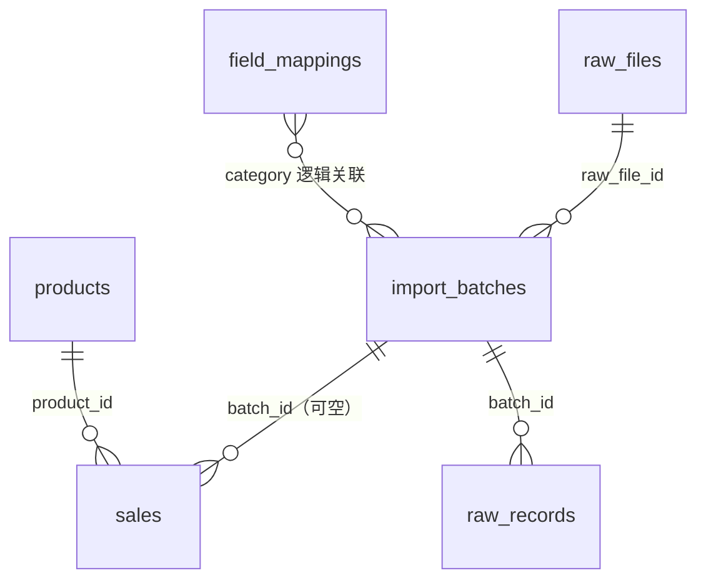
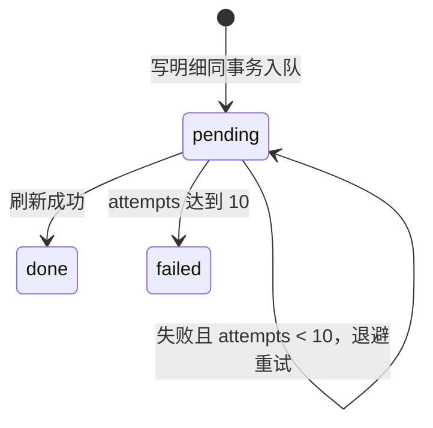

# go_api 数据模型说明

> 范围：`go_api/internal` 下所有 GORM 模型结构体（各包 `model.go`）以及 `summary.RefreshTask`。
> 目标：说明每个结构体对应的表、字段语义、约束和彼此关联，作为改表、加字段、排查数据问题时的参考。
> 约定：结构体注释与本文档保持同步；本文档不替代 `docs/architecture.md` 的分层与流程说明。

---

## 1. 模型总览

| 结构体 | 源文件 | 表名 | 分层 | 职责 |
|---|---|---|---|---|
| `product.Product` | `internal/product/model.go` | `products` | 维度 | 品类维度，如 phone、laptop |
| `sales.Sales` | `internal/sale/model.go` | `sales` | DWD 明细 | 映射后的标准销售明细 |
| `summary.SalesSummary` | `internal/summary/model.go` | `dws_sales` | DWS 汇总 | 按 grain 预聚合的指标 |
| `summary.RefreshTask` | `internal/summary/task.go` | `summary_refresh_tasks` | 任务队列 | 汇总刷新的 outbox 记录 |
| `raw.ImportBatch` | `internal/raw/model.go` | `import_batches` | ODS 原始 | 一次导入的批次元信息 |
| `raw.RawRecord` | `internal/raw/model.go` | `raw_records` | ODS 原始 | 单行解析快照，JSONB |
| `raw.RawFile` | `internal/raw/model.go` | `raw_files` | ODS 原始 | 原始文件字节与 SHA-256 |
| `mapping.FieldMapping` | `internal/mapping/model.go` | `field_mappings` | 映射 | 源列名到标准字段的规则 |

所有表由 `router.MustMigrate` 调用 `AutoMigrate` 创建，另有手工 SQL 索引（见第 12 节）。
数据库中**没有外键约束**，表之间的关联全部由应用层维护，字段含义依靠命名和本文档对齐。



`dws_sales` 由 `sales` 按 grain 聚合派生，`summary_refresh_tasks` 由写明细的事务入队，二者都不保留指向明细行的外键，因此不画在 ER 图中，见第 11 节的数据流。

---

## 2. 通用约定

| 约定 | 说明 |
|---|---|
| 主键 | `ID`，`uint` 自增；`summary.RefreshTask` 用 `int64` |
| 时间 | `time.Time`；`CreatedAt`、`UpdatedAt` 由 GORM 自动维护，`dws_sales` 只有 `UpdatedAt` |
| 金额 | `github.com/shopspring/decimal` + `numeric(18,4)`，不使用 `float64` |
| JSON | `encoding/json.RawMessage` + `jsonb`，值由应用层序列化 |
| 命名 | 结构体用单数，表名默认 GORM 复数（`Sales` 复数仍为 `sales`） |
| 显式表名 | `dws_sales`、`raw_files`、`summary_refresh_tasks` 通过 `TableName()` 指定 |
| JSON 字段 | 统一 snake_case，与接口返回一致 |
| 空值 | 可空关联用指针（`*uint`）表达，如 `sales.batch_id`、`import_batches.raw_file_id` |

迁移清单（`AutoMigrate` 的顺序）：

```go
product.Product, sale.Sales,
raw.ImportBatch, raw.RawRecord, raw.RawFile,
mapping.FieldMapping,
summary.SalesSummary, summary.RefreshTask
```

---

## 3. Product（`products`）

品类维度。此处的「商品」是粗粒度品类，不是具体型号；具体商品由 `sales` 的 `productor + name` 表达。

| 字段 | 类型 | 约束 | JSON | 说明 |
|---|---|---|---|---|
| `ID` | `uint` | 主键 | `id` | 自增主键 |
| `Name` | `string` | `not null`，唯一索引 | `name` | 品类名，如 phone、laptop；导入接口的 `category` 即取此值 |
| `Description` | `string` | 可空 | `description` | 品类说明 |
| `Price` | `float64` | `not null`，默认 0 | `price` | 品类默认价格，仅供展示；统计金额以 `sales.price` 为准 |
| `CreatedAt` | `time.Time` | 自动维护 | `created_at` | 创建时间 |
| `UpdatedAt` | `time.Time` | 自动维护 | `updated_at` | 更新时间 |

使用要点：

- `Name` 唯一，是映射、导入、汇总三处共用的品类标识。
- `sales.product_id`、`dws_sales.product_id` 都指向这里的 `ID`，不是具体 SKU。
- 通过 `POST /api/products` 创建，`Name` 必填。

---

## 4. Sales（`sales`）

明细层的销售事实表。一行表示「某品类、某品牌、某型号、某月份」的一条销售记录，由原始行经映射转换后写入。

| 字段 | 类型 | 约束 | JSON | 说明 |
|---|---|---|---|---|
| `ID` | `uint` | 主键 | `id` | 自增主键 |
| `ProductID` | `uint` | `not null`，索引 | `product_id` | 品类 ID，指向 `products.id` |
| `BatchID` | `*uint` | 索引，可空 | `batch_id` | 来源批次，指向 `import_batches.id`；可空以兼容历史数据 |
| `Productor` | `string` | `not null`，索引 | `productor` | 品牌或厂商，如 Apple |
| `Name` | `string` | `not null`，索引 | `name` | 商品型号名 |
| `Price` | `decimal.Decimal` | `numeric(18,4)`，`not null` | `price` | 单价 |
| `Sales` | `int64` | `not null` | `sales` | 销量（件），非负 |
| `Month` | `string` | `varchar(7)`，`not null`，索引 | `month` | 统计月份，格式 `YYYY-MM` |
| `Attrs` | `json.RawMessage` | `jsonb`，`not null`，默认 `{}` | `attrs` | 非标准列的键值快照 |
| `CreatedAt` | `time.Time` | 自动维护 | `created_at` | 创建时间 |
| `UpdatedAt` | `time.Time` | 自动维护 | `updated_at` | 更新时间 |

使用要点：

- **一行不是订单明细**，而是已经按商品 + 月份归并口径的销售记录；转换后同一批次整体替换（先删后插），保证幂等。
- `BatchID` 为指针以兼容历史数据；当前所有写入路径都会落批次，手工导入（`POST /api/sales/batch`）会创建 `source=manual` 的批次。`dws_sales.batch_count` 不统计 NULL 行。
- `Attrs` 的键是源表中所有不属于标准字段的列（不做映射翻译），值为字符串形式。属性报表直接扫描该列，依赖 GIN 索引 `idx_sales_attrs`。
- `Price` 是单价，销售额为 `price * sales`，由汇总层计算，不落明细列。
- 批次删除或重新转换时，`sales` 对应行会被整体替换，历史汇总通过 `summary_refresh_tasks` 异步重算。

---

## 5. SalesSummary（`dws_sales`）

汇总层的预聚合表，按 grain 提供可加指标。

**唯一粒度（grain）**：`(product_id, productor, name, month)`，即 `uk_dws_grain`。

| 字段 | 类型 | 约束 | JSON | 说明 |
|---|---|---|---|---|
| `ID` | `uint` | 主键 | `id` | 自增主键 |
| `ProductID` | `uint` | `uk_dws_grain` 第 1 列 | `product_id` | 品类 ID |
| `Productor` | `string` | `uk_dws_grain` 第 2 列，`idx_dws_brand` | `productor` | 品牌或厂商 |
| `Name` | `string` | `uk_dws_grain` 第 3 列 | `name` | 商品型号名 |
| `Month` | `string` | `uk_dws_grain` 第 4 列，`idx_dws_month` | `month` | 统计月份 `YYYY-MM` |
| `TotalSales` | `int64` | `not null`，默认 0 | `total_sales` | `SUM(sales)` |
| `TotalAmount` | `decimal.Decimal` | `numeric(18,4)`，`not null` | `total_amount` | `SUM(price * sales)` |
| `PriceSum` | `decimal.Decimal` | `numeric(18,4)`，`not null` | `price_sum` | `SUM(price)` |
| `RecordCount` | `int` | `not null`，默认 0 | `record_count` | `COUNT(*)` |
| `MinPrice` | `decimal.Decimal` | `numeric(18,4)` | `min_price` | 最低单价 |
| `MaxPrice` | `decimal.Decimal` | `numeric(18,4)` | `max_price` | 最高单价 |
| `BatchCount` | `int` | `not null`，默认 0 | `batch_count` | `COUNT(DISTINCT batch_id)`，NULL 历史行不计入 |
| `UpdatedAt` | `time.Time` | 刷新时写入 | `updated_at` | 最近重算时间 |

派生指标（查询时计算，不落库）：

| 指标 | 公式 |
|---|---|
| 成交均价 | `SUM(total_amount) / SUM(total_sales)` |
| 最低 / 最高单价 | `MIN(min_price)` / `MAX(max_price)` |

刷新语义：

- 按 grain 先 `DELETE` 再 `INSERT`（`RefreshGrainsTx`），不是逐行 UPSERT，因此没有 `CreatedAt`。
- 刷新任务由写明细的事务入队，worker 异步执行；`dws_sales` 允许短暂滞后。
- `Grain` 是与本表粒度对应的值类型（定义在 `internal/summary/repository.go`），用于任务载荷与刷新参数，不是独立表。

---

## 6. RefreshTask（`summary_refresh_tasks`）

汇总刷新任务表，采用 outbox 模式：与明细写入同事务落库，worker 只处理已提交的任务。

| 字段 | 类型 | 约束 | JSON | 说明 |
|---|---|---|---|---|
| `ID` | `int64` | 主键 | `id` | 自增主键 |
| `Grains` | `string` | `text`，`not null` | `grains` | 待重算 grain 列表的 JSON 数组 |
| `Status` | `string` | `not null`，默认 `pending`，索引 | `status` | `pending` / `done` / `failed` |
| `Attempts` | `int` | `not null`，默认 0 | `attempts` | 已失败次数 |
| `RunAfter` | `time.Time` | `not null`，默认 `now()`，索引 | `run_after` | 下次可执行时间 |
| `LastError` | `string` | `text`，`not null`，默认空串 | `last_error` | 最近一次失败原因 |
| `CreatedAt` | `time.Time` | 自动维护 | `created_at` | 入队时间 |

状态流转与重试：

- `pending` 执行成功置 `done`，并清空 `last_error`。
- 执行失败时 `attempts + 1`，按 `2^attempts` 秒退避（最大 64 秒）后重试；累计 10 次仍失败则置 `failed`。
- `grains` 为 JSON 数组文本，元素形如 `{"product_id":1,"productor":"Apple","name":"iPhone 15","month":"2024-01"}`。



---

## 7. ImportBatch（`import_batches`）

一次导入的批次元信息，是原始文件、原始行、明细行之间的溯源节点。

| 字段 | 类型 | 约束 | JSON | 说明 |
|---|---|---|---|---|
| `ID` | `uint` | 主键 | `id` | 自增主键 |
| `Source` | `string` | `not null` | `source` | 来源标识，通常为文件名；手工批次为 `manual` |
| `Category` | `string` | `not null`，索引，`uk_batch_cat_file` 第 1 列 | `category` | 品类，对应 `products.name` |
| `Status` | `string` | `not null`，默认 `loaded`，索引 | `status` | 批次状态 |
| `RowCount` | `int` | `not null`，默认 0 | `row_count` | 原始行数 |
| `FileHash` | `string` | `char(64)`，`not null`，索引 | `file_hash` | 原始文件 SHA-256，冗余自 `raw_files` |
| `RawFileID` | `*uint` | `uk_batch_cat_file` 第 2 列，可空 | `raw_file_id` | 指向 `raw_files.id` |
| `ReaderVersion` | `string` | `varchar(32)`，`not null` | `reader_version` | 解析器版本 |
| `CreatedAt` | `time.Time` | 自动维护 | `created_at` | 创建时间 |
| `UpdatedAt` | `time.Time` | 自动维护 | `updated_at` | 更新时间 |

状态取值（`internal/raw/model.go` 常量）：

| 常量 | 值 | 含义 |
|---|---|---|
| `StatusLoaded` | `loaded` | 已落库，尚未转换 |
| `StatusMapped` | `mapped` | 已转换，明细层有对应 `sales` 行 |
| `StatusFailed` | `failed` | 历史失败状态；当前流程不再写入，仅兼容旧数据 |

使用要点：

- 唯一索引 `uk_batch_cat_file(category, raw_file_id)` 保证同一文件、同一品类只建一个批次；重复上传返回已有批次（`duplicated=true`），不重复写 `raw_records`。
- SQL 唯一索引不会约束 NULL，`raw_file_id` 为 NULL 时该约束不生效；手工批次（`source=manual`）没有原始文件，`raw_file_id` 为 NULL，正常上传链路都会写入该字段。
- `file_hash` 与 `raw_files.sha256` 冗余，便于按文件反查批次，不承担唯一性职责。

---

## 8. RawRecord（`raw_records`）

原始行层的一条解析快照。键保持源表列名原样，可随时由 `raw_files.content` 重新解析生成。

| 字段 | 类型 | 约束 | JSON | 说明 |
|---|---|---|---|---|
| `ID` | `uint` | 主键 | `id` | 自增主键 |
| `BatchID` | `uint` | `not null`，索引 | `batch_id` | 所属批次，指向 `import_batches.id` |
| `RowIndex` | `int` | `not null` | `row_index` | 行序号，从 0 开始；报错时加 1 展示 |
| `RowData` | `json.RawMessage` | `jsonb`，`not null` | `row_data` | 原始键值，键为源列名 |
| `CreatedAt` | `time.Time` | 自动维护 | 无显式 tag | 创建时间，仅内部使用，不属于接口出参 |

使用要点：

- 列名不做标准化，标准化只发生在映射层（`field_mappings`）。
- 删除批次时，应用层同时删除该批次的 `raw_records`；原始文件 `raw_files` 不随之删除。
- 转换读取全部行后整批替换 `sales`，任何一行校验失败都不会产生部分写入。

---

## 9. RawFile（`raw_files`）

原始文件表，保存原始字节与指纹，是去重、校验和重放（规划中）的依据。

| 字段 | 类型 | 约束 | JSON | 说明 |
|---|---|---|---|---|
| `ID` | `uint` | 主键 | `id` | 自增主键 |
| `SHA256` | `string` | `char(64)`，`not null`，唯一索引 | `sha256` | 文件内容哈希，服务端重算 |
| `Size` | `int64` | `not null` | `size` | 字节数 |
| `Filename` | `string` | `text`，`not null` | `filename` | 原始文件名 |
| `ContentType` | `string` | `text`，`not null`，默认空串 | `content_type` | 上传时的 MIME 类型 |
| `StorageKind` | `string` | `varchar(16)`，`not null`，默认 `db` | `storage_kind` | 字节存放方式，当前固定 `db` |
| `ObjectKey` | `string` | `text`，`not null`，默认空串 | `object_key` | 对象存储键，`db` 模式下为空 |
| `Content` | `[]byte` | `bytea` | 不输出 | 原始字节 |
| `CreatedAt` | `time.Time` | 自动维护 | `created_at` | 创建时间 |

使用要点：

- `sha256` 唯一，同一份内容全局只存一行；重复上传命中已有行并复用 `ID`。
- `Content` 带 `json:"-"`，任何接口都不会返回原始字节。
- 当前没有自动清理机制，文件量增长会放大数据库体积（见 `docs/architecture.md` 已知限制）。

---

## 10. FieldMapping（`field_mappings`）

映射层规则：一条「用户列名 → 标准字段」的翻译。

| 字段 | 类型 | 约束 | JSON | 说明 |
|---|---|---|---|---|
| `ID` | `uint` | 主键 | `id` | 自增主键 |
| `Category` | `string` | `not null`，`uk_mapping_cat_col` 第 1 列 | `category` | 品类 |
| `SourceColumn` | `string` | `not null`，`uk_mapping_cat_col` 第 2 列 | `source_column` | 源表列名 |
| `TargetField` | `string` | `not null` | `target_field` | 标准字段，必须在白名单内 |
| `CreatedAt` | `time.Time` | 自动维护 | `created_at` | 创建时间 |
| `UpdatedAt` | `time.Time` | 自动维护 | `updated_at` | 更新时间 |

配套常量：

- `StandardFields = [productor, name, price, sales, month]`：目标字段白名单，防止写错列。
- `RequiredFields`：转换时必须有值的字段；只进白名单不进必填表的字段为可选字段。

使用要点：

- 唯一键是 `(category, source_column)`；`target_field` 故意不唯一，允许不同源列指向同一目标字段。
- `Upsert` 命中唯一键时只更新 `target_field` 和 `updated_at`，重复配置不报错。
- 解析优先级：显式规则 → 源列名本身是标准字段（恒等回退）→ 未匹配列记入 `ignored_columns`，值写入 `sales.attrs`。

---

## 11. 关联与数据流

| 关系 | 关联字段 | 说明 |
|---|---|---|
| 品类 → 明细 | `sales.product_id` → `products.id` | 一个品类下多条明细 |
| 原始文件 → 批次 | `import_batches.raw_file_id` → `raw_files.id` | 同一文件可对应多个品类批次 |
| 批次 → 原始行 | `raw_records.batch_id` → `import_batches.id` | 删除批次时一并清理 |
| 批次 → 明细 | `sales.batch_id` → `import_batches.id` | 可空；正常链路均写入，手工批次 `source=manual` |
| 明细 → 汇总 | `dws_sales(product_id, productor, name, month)` | 按 grain 聚合，不保留明细 ID |
| 映射 → 批次 | `field_mappings.category` = `import_batches.category` | 逻辑关联，无外键 |
| 明细 → 任务 | 写明细事务内插入 `summary_refresh_tasks` | outbox，异步刷新汇总 |

数据流：

```text
RawFile (raw_files)
  -> ImportBatch (import_batches)
    -> RawRecord (raw_records)         原始列名
      -> [FieldMapping 规则 + 恒等回退]
        -> Sales (sales)               标准字段 + attrs
          -> SalesSummary (dws_sales)  按 grain 聚合
```

---

## 12. 索引与约束汇总

| 表 | 索引 / 约束 | 来源 |
|---|---|---|
| `products` | `name` 唯一 | `uniqueIndex` |
| `sales` | `product_id`、`batch_id`、`productor`、`name`、`month` 普通索引 | GORM tag |
| `sales` | `idx_sales_attrs`：`USING gin (attrs jsonb_path_ops)` | `MustMigrate` 手工 SQL |
| `dws_sales` | `uk_dws_grain(product_id, productor, name, month)` 唯一 | GORM tag |
| `dws_sales` | `idx_dws_brand(productor)`、`idx_dws_month(month)` | GORM tag |
| `import_batches` | `uk_batch_cat_file(category, raw_file_id)` 唯一 | GORM tag + 手工校验重建 |
| `import_batches` | `category`、`status`、`file_hash` 普通索引 | GORM tag |
| `raw_records` | `batch_id` 普通索引 | GORM tag |
| `raw_files` | `sha256` 唯一 | `uniqueIndex` |
| `field_mappings` | `uk_mapping_cat_col(category, source_column)` 唯一 | GORM tag |
| `summary_refresh_tasks` | `status`、`run_after` 普通索引 | GORM tag |

---

## 13. 修改约定与注意事项

新增或修改模型时：

1. 同步修改结构体字段与注释，并更新本文档对应表格。
2. 金额字段用 `decimal.Decimal` + `numeric(18,4)`，不要引入 `float64`。
3. 可空关联用指针；新增 JSONB 字段时考虑是否需要 GIN 索引。
4. 改表名或列名要评估旧数据兼容性；`AutoMigrate` 只做增量，不删列。
5. 新表需要加入 `router.MustMigrate` 的迁移清单。
6. 涉及汇总粒度的字段变更，必须同步 `summary.Grain`、`uk_dws_grain` 和刷新 SQL。

已知限制（与模型相关）：

- `raw_files.content` 以 `bytea` 存库，没有清理机制，体积会持续增长。
- `dws_sales` 允许短暂滞后，读取方需接受最终一致。
- `sales.attrs` 属于探索口径，不进入汇总层。
- 数据库无外键，删除顺序和数据一致性由应用层事务保证。
- `import_batches` 在 `raw_file_id` 为 NULL 时唯一约束不生效，仅靠正常链路避免脏数据。
